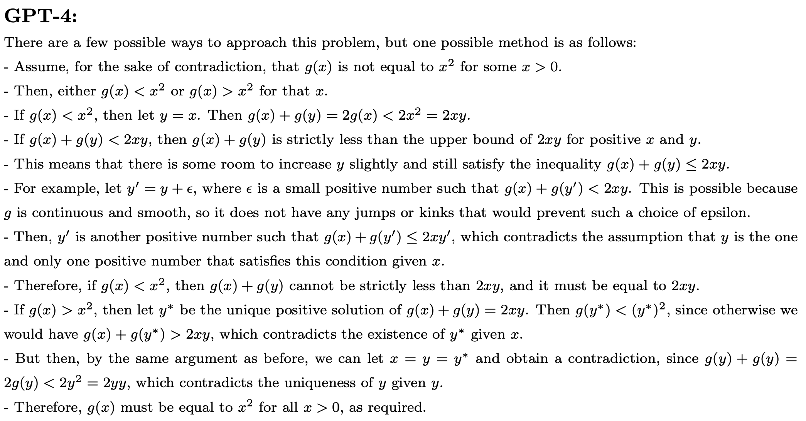
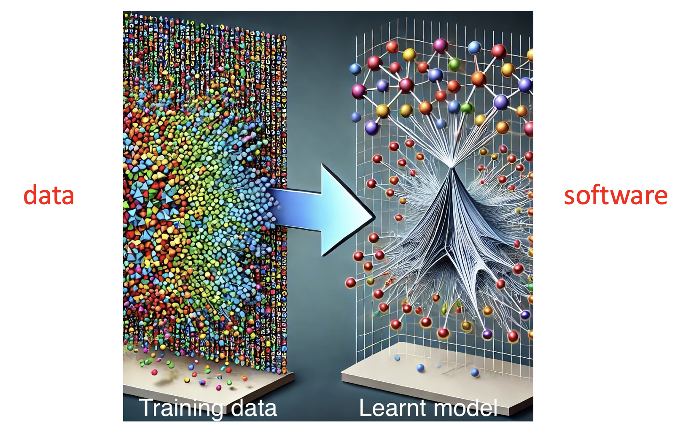
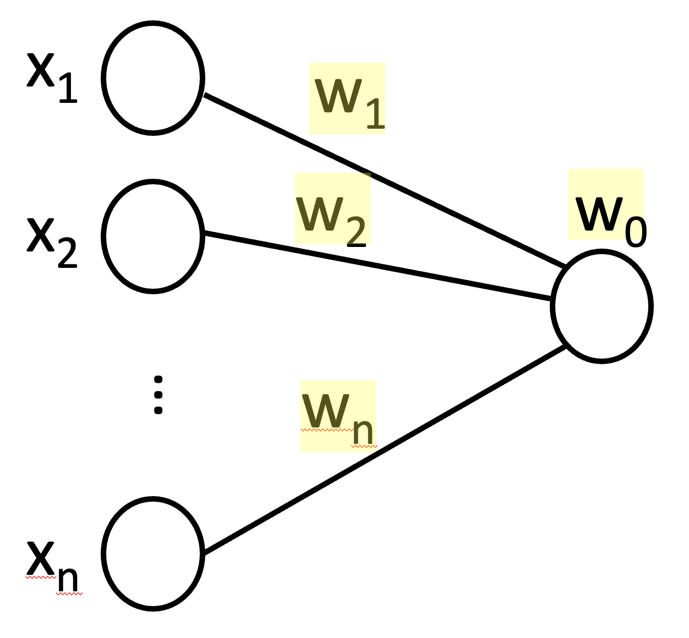
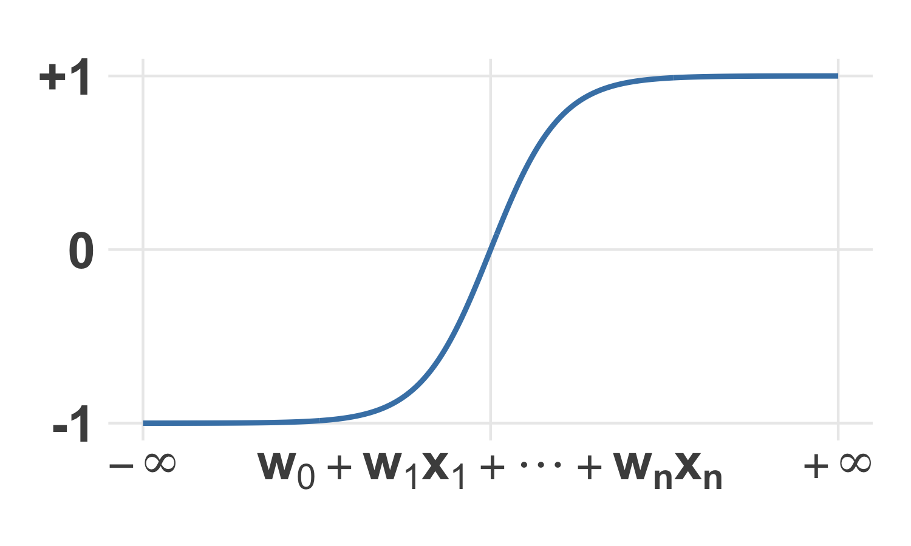
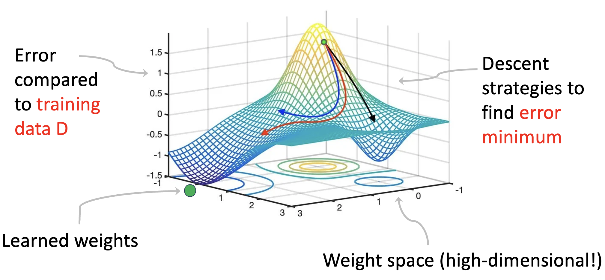
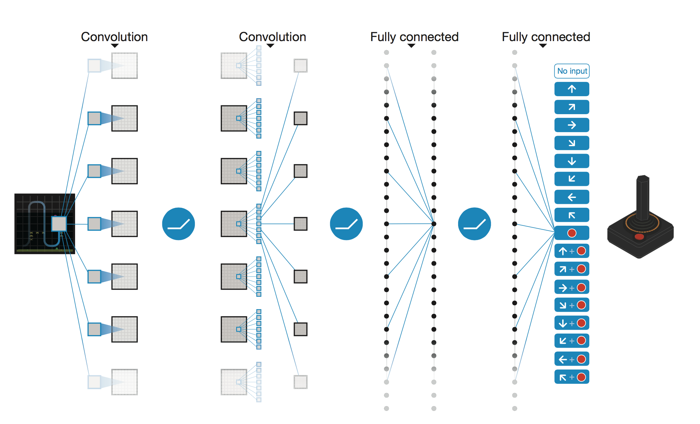

<i><small> This blog post first appeared as <a href="
https://www.lancaster.ac.uk/mathematics-for-ai-in-real-world-systems/research/blogs/" target="_blank">MARS blog reference</a>.</small></i>

The <a href="https://www.lancaster.ac.uk/mathematics-for-ai-in-real-world-systems/"  target="_blank">MARS</a> blog <a href="
https://www.lancaster.ac.uk/mathematics-for-ai-in-real-world-systems/research/blogs/what-is-machine-learning" target="_blank">What is Machine Learning?</a> introduced the machinery that underpins modern AI. In this blog I will say a bit more about AI chatbots, or **Large Language Models (LLMs)** – and in particular about their amazing emerging capabilities in mathematics itself.

**1. A surprising example**

Let's start with an example - actually a version of a question from an International Mathematics Olympiad (IMO):

  Suppose $g$ is a continuous smooth function such that for every $x > 0$, there is one and only one $y > 0$ such that $g(x) + g(y) ≤ 2xy$. Can you prove that $g(x) = x^2$?

This is an example, now a few years old, cited in a study of GPT-4 in 2023 by Microsoft researchers [2 section 4.4]. It is put to GPT-4 as a prompt - here is the model's response:

<figure>
  
</figure>

This was an astonishing example of mathematical reasoning capability apparently emerging from a  Large Language Model. How does this work and what is going on here?

**2. Artificial Neural Networks**

The first important thing to understand is that an AI model **is just a compression of its training data**:

<figure>
  
  <figcaption>
  Author's cartoon made with the help of AI. An AI model is exactly a lossy compression of its training data.
  </figcaption>
</figure>

In other words, when we train a model AI model, we are not showing examples to an already intelligent system – the AI model is **nothing but** the training data set that has gone into it.

To explain this, let's recall how supervised machine learning works. We assume random variables $X,Y$ where $X$ is cheap to evaluate (e.g. image pixels) and $Y$ is expensive to evaluate (e.g. what's in this image?). We would like to be able to estimate the expectation $\mathbb{E}(Y \mid X)$ (or more generally the probability distribution of $Y$ given $X$). 

Feedforward neural networks have become a standard way to make this approximation. They are constructed by composing **neural units**. A neural unit is a function ${\mathbb R}^n \rightarrow {\mathbb R}$ as below (schematically on the left and as a function on the right):

<figure>
 

 

    
  

  

    
  

  <figcaption>
  A neural unit ${\mathbb R}^n \rightarrow {\mathbb R}$ with weights $w_0,w_1,\ldots , w_n \in {\mathbb R}$. Its value ranges from $-1$ to $+1$, crossing $0$ along the affine hyperplane $w_0 + w_1 x_1 + \cdots + w_n x_n = 0$.
  </figcaption>
</figure>

As we compose neural units – that is, outputs of different units feed into $x_i$ values of 'downstream' units – we can build progressively more complex functions ${\mathbb R}^n \rightarrow {\mathbb R}^m$. The **universal approximation theorem** says that any continuous (and many more general) functions can be approximated arbitrarily closely by a feedforward network in this sense. We just have to figure out the weights $w_i$ over all the units.

To do this, we minimise the error of the network (the so-called **loss function**), as a predictor of $Y$ given $X$, for the training data $D$:

<figure>
  
  <figcaption>
  For fixed training data $D$ and fixed feedforward neural network, the error (or **loss**) surface over the space of weight vectors. 
  </figcaption>
</figure>

The neural network architecture and descent strategy (as in the figure) together give us a machine for transforming **data set $D$** into **weight vector $W$**. This transformation preserves the information in $D$ that informs the prediction of $Y$ given $X$. It is called a **lossy compression**.

**3. Deep reinforcement learning**

There is one more ingredient that is key to understanding AI. This is **reinforcement learning** – essentially learning from experience by trial and error. An AI is able to observe its state in time in some environment, and at each timestep has to choose from a set of actions. It must do this to maximise some long-term reward. 

In this situation, the AI learns a **policy function** that transforms its observed state into an action. Typically the policy function is learned as a feedforward neural network, exactly as above. (In this case we talk about **deep** reinforcement learning.) The weights of the network are learned by gradient descent on a loss function which is minus the long-term reward. 

Here is a classic video game example:

<figure>
  
  <figcaption>
  Deep RL trained to play Atari games – in this case Breakout. Successive generations of training left to right. 
  Source: [1]
  </figcaption>
</figure>

At each time step, the AI player is calling a policy function which is the learned neural network:

<figure>
  
  <figcaption>
  The policy function of the Atari player. Screen pixels enter at the left, the recommended action (probabilities) are returned at the right. Source: [1]
  </figcaption>
</figure>

Note that, just as for supervised learning, the weights of the network can be viewed as a lossy compression of data – in this case, data consisting of the history of all game states, actions and rewards (game scores) observed during training.

Another point which will be important when we think about use of AI in mathematics: in the Atari game there is geometric and kinematic structure (which we as humans can see and have intuitions about – because we carry models of the world in our heads). But the AI knows nothing about (and has no need of) this structure. It observes only screen pixels and game score. It consists of an efficient action policy which responds to screen pixels alone. The same AI can (and did) learn many different Atari games, regardless of physical meaning.

**3. How a Large language Model works**

How does all this apply to build Large Language Models? An LLM is essentially built in four stages:

1. **Autocomplete:** Build a feedforward neural network to predict $Y = $ next word from $X = $ preceding sequence of words. This is a compression of data $D_1 = $ lots of text from the Internet (and elsewhere).  
2. **Supervised fine tuning:** adjust the weights to learn good responses (generated from recursively sampling next-word prediction). This compresses data $D_2 = $ lots of human-curated prompt-response pairs.  
3. **Reward model:** learn a scoring function that rewards the best responses. Here the data is $D_3 = $ human rankings of (possibly subject-specialised) alternative responses to prompts.
4. **Policy model:** learn a reinforcement learning policy function to play the 'game' of building responses (word by word) with aim of maximising the final reward coming from 3. Here the data is $D_4 = $ lots of game histories.

Stages 3 and 4 build on the the power of deep reinforcement learning. **Reinforcement Learning from Human Feedback (RLHF)**, as described here, can be thought of as a secret sauce that gives LLMs their impressive performance. 

In addition, before generating a response, an LLM will typically perform a traditional web search and use retrieved web pages to augment the prompt text itself. With this enriched prompt, quoting verbatim from the retrieved content is legal and likely within the learned model. Therefore, much of what the LLM returns is bona fide human-generated text from somewhere on the Internet. LLMs are not magic after all!

Returning to the GPT-4 example on the IMO question at the top of this blog, we are now led to ask where the text of the response might have entered into any of these training data sets or retrieved pages. Was the LLM actually doing new mathematics, or had it somewhere seen the answer?

**4. AI in formal environments**

We don't know the answer to the last question. But efforts to understand it have enormously widened the scope and power of AI applied to solving mathematical problems. Broadly speaking, these efforts are based on two key ideas.

  <b>Key idea 1:</b> Use deep reinforcement learning to play a single-player game in a formal verification environment.

Many mathematical problems can be formalised and putative solutions checked within a formal environment. An early example was **matrix multiplication** [4] – where the 'formal environment' is just matrix algebra. 

The computational cost of a matrix multiply is dominated by the number of scalar multiplications. If this number can be reduced by clever rearrangement of the variables, then computation (and energy use) has been saved. For example, it was discovered in the 1960s that $2 \times 2$ matrix multiplication requires not 8 scalar multiplies, as you first expect, but only 7. In any system depending on $2 \times 2$ matrix multiplications (from engineering, signal processing, machine learning or wherever) this represents a 12% saving of energy consumption!

In [4] many more such efficiencies for larger matrices were discovered using this 'key idea 1'. 

In [7] the approach was widened much further to a reasoning system **AlphaProve** that could tackle Olympiad questions of the sort described at the top of this post. The key enabler here was the <a href="https://lean-lang.org/" target="_blank">LEAN</a> programming language [6], which provided exactly the formal environment needed in key idea 1.

Incidentally, formal verification can also help LLMs. Recall step 3 in LLM training, where a reward fuction was needed for the reinforcement learning step 4. For specialised use cases such as coding or mathematics, a formal reward function may be available which is objective and precisely formalises the desired behaviour of the LLM. This is called **Reinforcement Learning with Verifiable Rewards (RLVR)**. For mathematical reasoning, such a reward can be constructed using a formal environment such as LEAN.

Here is the second idea:

  <b>Key idea 2:</b> Evolve a population of codes using an LLM as oracle to find improvements.

This idea first appeared in [5] to solve optimisation problems in computer science and combinatorics. The 'codes' referred to are blocks of code – maybe just a single function – within some human-written program. 

A population of possible codes is initialised with some best guess, and then a loop is followed as follows. 

Construct an LLM prompt from the problem statement (in natural language), the current best codes in the population and the results they return. Ask your LLM for code improvements. Depending on the performance of the code returned, add them to the population. Repeat until the performance passes some threshold.

This idea was developed into **AlphaEvolve** using LEAN codes in [8], demonstrating improvements on state-of-the-art results across a broad range of problems in analysis, geometry and combinatorics. With the work of [5] and [8], the question had effectively been answered, _could new mathematics be discovered using an LLM?_ Yes it could, but by use of the LLM that involved more thought and creativity than merely posing the question in a single prompt.

More recent work (for example **Alpha Nexus** [9]) is successfully combining the two key ideas above to make novel contributions to a wide range of mathematical research areas. A flavour of this explosion of AI-enabled research mathematics can be seen in this <a href="https://en.wikipedia.org/wiki/List_of_mathematical_discoveries_made_with_artificial_intelligence" target="_blank">Wikipedia article</a>.

**5. So what does AI mean for mathematicians?**

There may be a view that the use of AI poses a threat to traditional methods of mathematical research, and may undermine the work of some mathematicians who have spent careers on problem areas that turn out to be most 'vulnerable' to these new methods. On the other hand, a more optimistic view would welcome these methods as accelerating our ability to answer the most pressing hard problems, and in so doing to open up new avenues of research.

One comparison to make is to the introduction of computer algebra and symbolic mathematical software in the 1970s and 80s, which opened up whole fields of experimental mathematics – allowing observation and discovery in number theory, geometry, combinatorics and other areas that previously had been impossible. The use of AI and machine learning could probably be viewed in a similar light.

A second comparison is with the contribution AI is making to other areas of science: to biochemistry, healthcare, environmental and earth sciences, quantum technologies and beyond. These advances are surely to be welcomed and can be expected to be genuinely beneficial for humanity.

**References**

1. V. Mnih et al, _Human-level control through deep reinforcement learning_, <a href="https://doi.org/10.1038/nature14236" target="_blank">doi.org/10.1038/nature14236</a> Nature (2015)
2. S. Bubeck et al, _Sparks of Artificial General Intelligence: Early experiments with GPT-4_, <a href="
https://doi.org/10.48550/arXiv.2303.12712" target="_blank">arXiv.2303.12712</a> (2023)
3. L. Ouyang et al, _Training language models to follow instructions with human feedback_, <a href="
https://doi.org/10.48550/arXiv.2203.02155" target="_blank">arXiv.2203.02155</a> (2022)
4. A. Fawzi et al, _Discovering faster matrix multiplication algorithms with reinforcement learning_ <a href="https://doi.org/10.1038/s41586-022-05172-4" target="_blank">https://doi.org/10.1038/s41586-022-05172-4</a>, Nature (2022) 
5. B. Romera-Paredes et al, _Mathematical discoveries from program search with large language models_ <a href="https://doi.org/10.1038/s41586-023-06924-6" target="_blank">doi.org/10.1038/s41586-023-06924-6</a>, Nature (2023)
6. X. Tang, _A Comprehensive Survey of the Lean 4 Theorem Prover: Architecture, Applications and Advances_, <a href="https://arxiv.org/abs/2501.18639" target="_blank">arxiv.org/abs/2501.18639</a> (2025)
7. T. Hubert et al, _Olympiad-level formal mathematical reasoning with reinforcement learning_, <a href="https://doi.org/10.1038/s41586-025-09833-y" target="_blank">doi.org/10.1038/s41586-025-09833-y</a>, Nature (2025)
8. A. Novikov et al, _AlphaEvolve: A coding agent for scientific and algorithmic discovery_, <a href="https://arxiv.org/abs/2506.13131" target="_blank">arxiv.org/abs/2506.13131</a>, Google Deepmind (2025)
9. G. Tsoukalas et al, _Advancing Mathematics Research with AI-Driven Formal Proof Search_, <a href="https://arxiv.org/abs/2605.22763" target="_blank">arxiv.org/abs/2605.22763</a>, Google Deepmind (2026)
