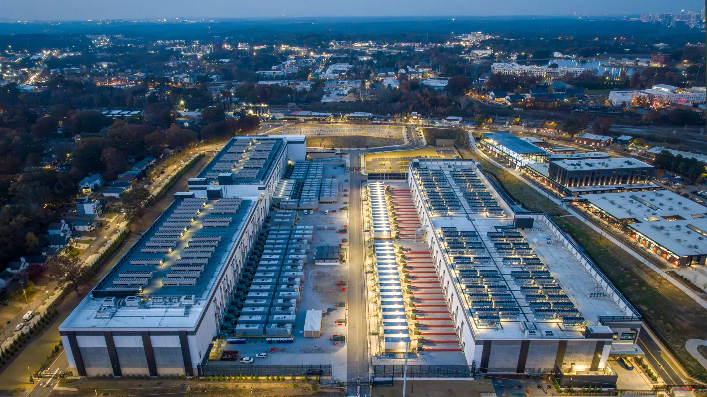
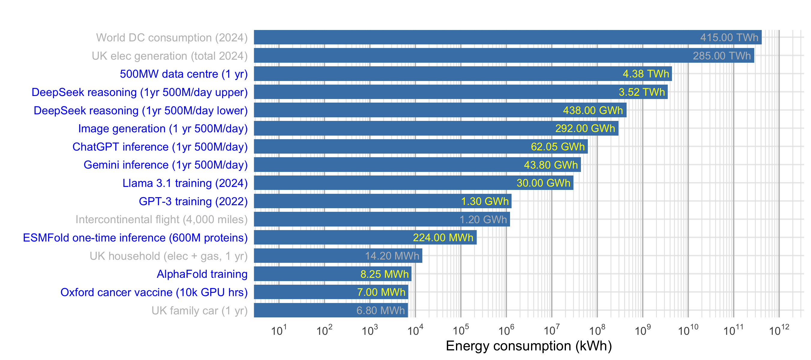

<figure>
  
  <figcaption>
  Image: MIT Technology Review
  </figcaption>
</figure>

<small>
**Summary:** 
UK government AI policy requires a blanket 500MW power supply for AI Growth Zone (AIGZ) approval. We argue that this figure serves solely to meet commercial hyperscaling demand. We advocate that if AIGZ approvals were based on sovereign AI capability _per unit energy_ (and per litre water, though we do not cover water in this article) – then such an approach would better align sovereign AI investment with sustainability, _and_ it would significantly favour AI for science, which is both a UK strength and orders of magnitude more energy efficient than hyperscaling.
</small>

___

Despite growing environmental risks and public opposition, the UK government wants every AI Growth Zone to secure 500MW of power. Run flat out, one zone would use about 2% of the UK's electricity. What is this energy needed for? The answer is hyperscaling of AI chatbot services. By comparison, AI for scientific applications, including their commercialisation, requires only a fraction of the energy. It is also a significant strength of the UK with high economic and social value.

In this article, we make a case for UK policy to prioritise scientific AI-compute allocation as more sustainable, a better fit to UK strengths and a stronger economic investment. 

**1. Public opposition to data centres**

In the US, data centres have been described as a great unifier. Across the political spectrum, whatever differences people may have on other matters, on one thing everyone is apparently agreed: nobody wants data centres where they live [4,5,6,7]. 

The reasons are clear: electricity prices, water use, farmland loss, a perception that jobs and benefits are thin, public health concerns [9]. Non-disclosure agreements between developers and local officials have aggravated distrust. Opposition has been organised and costly for developers, with dozens of projects have been delayed or blocked, billions of dollars of investment affected and growing pressure for local and statewide moratoria.

Data centres have been a core part of digital infrastructure since the early days of the Internet. What is different today is the rapid growth of processing demand for AI workloads. That processing entails a footprint in physical space, energy consumption and water for cooling which competes with other needs of local populations.

The same frictions are coming to other countries including the UK. The clearest public evidence to date is Slough: DESNZ statistics [10] show a large rise in local electricity consumption between 2015 and 2024, attributed to data centres, while the rest of the area's demand fell. Opposition is mobilising [8].

**2. UK government policy on AI growth**

The <a href="https://www.gov.uk/government/publications/ai-opportunities-action-plan/ai-opportunities-action-plan" target="_blank">AI Opportunities Action Plan</a> [1] introduced AI Growth Zones (AIGZ) "to facilitate the accelerated build out of AI data centres". The paper argued "as AI infrastructure providers seek access to land and power, governments who move quickly and mirror the pace of growth and innovation in the AI data centre market will be best placed to secure investment."

The implementation framework for AIGZs was set out in DSIT's paper <a href="https://www.gov.uk/government/publications/delivering-ai-growth-zones/delivering-ai-growth-zones" target="_blank">Delivering AI Growth Zones</a> [2].
In this framework, the criteria set out for an AIGZ location comprise: at least 100 acres available for construction by 2028 ... and access to at least 500MW of power by 2030, plus 'sufficient water'. 

Water is mentioned only qualitatively, and without any published consumption standard. Depending on cooling technology, a 500MW site might use anywhere between 2 and 35 million litres a day.

At the time of writing five AIGZs have been approved: at Culham (Oxfordshire) and in North East England, North Wales, South Wales and Lanarkshire (Scotland).

**The main aim of this article is to examine the case for, and the consequences of, the power figure of 500MW.** The basis for this figure is not given in either of the two government papers. 

As an indicator of the number of processors that can be run, power availability directly correlates to other factors such as physical size of the data centre, water requirement for cooling, noise pollution and carbon emissions. We will focus on power consumption as a proxy for these other factors. This will allow for transparent comparisons between data centre (and other energy-consuming) use cases.

For immediate context, a 500MW site running continuously would use about 4.4TWh a year. (See Figure 1 below.) The UK consumed about 249TWh of electricity in 2024, so one zone at full load is nearly 2% of national consumption. Regionally the effect is larger: for example, for the North East the 2024 energy consumption was 9.9TWh (equivalent to 1.1 GW of continuous demand) [10] – so that a 500 MW facility would correspond to a whopping 44% of the region's metered consumption.

We will look next at how this figure of 500MW meet the needs of AI use cases.

**3. Energy requirements for hyperscaling generative AI**

Here are some figures on AI demand cited by major providers:

| Provider | Disclosed figure | Source |
| --- | --- | --- |
| ChatGPT (OpenAI) | More than 2.5 billion prompts a day; up from about 1 billion in December 2024 | OpenAI, July 2025 [12]; still the figure quoted in 2026 |
| ChatGPT (OpenAI) | 1 billion weekly users | OpenAI, August 2026 [13] |
| Google | Over 3.2 quadrillion tokens a month (roughly 100 trillion a day), up seven-fold in a year | Google I/O, May 2026 [14] |
| Gemini app (Google) | More than 1 billion monthly users; over 150 million images a day | Google, August 2026 [15] |
| Google Search | Roughly 14 to 16 billion queries a day | Google, 2025 |
| Siri (Apple) | 2.5 billion requests a day | Apple event, September 2026 (reported) [16] |

When it comes to planning we can view these figures as conservative. While they are global and not restricted to the UK, they may be underestimates of future demand for a number of reasons. Volumes are growing rapidly; Google's token throughput rose seven-fold in a year. At the same time, some of the figures are older and can be expected be higher today. Per-prompt figures typically describe median, short prompts. In the table we don't see the distribution of long-context, reasoning-heavy, video or agentic requests (which will cost more in energy). Significantly, API, enterprise and embedded uses (search summaries, voice assistants, coding tools) sit outside the consumer chat counts, but can be expected to be a large and growing source of demand. Finally, experimentation, training and AI model development are not visible in these figures.

So the table above can be considered a conservative baseline for (global) data centre usage. 

Let's translate this usage into energy requirements. Compiled from various sources, here are some current platforms and prompt types with corresponding energy load per million queries:

| Workload | Per million prompts | Source |
| --- | --- | --- |
| Text, median Gemini prompt (full serving stack) | 240 kWh | Measured: Google, 2025 [18] |
| Text, average ChatGPT prompt | 340 kWh | Reported: OpenAI, method not disclosed [20] |
| Text, DeepSeek-R1 (reasoning), short prompt (100 in, 300 out) | 2.4 to 19.3 MWh | Published, modelled estimate [19]; range across Azure and DeepSeek hosting |
| Image, mean across models tested | 2.9 MWh | Published [17]; older hardware |

Note that image (and especially video, not included here) is more expensive than text. Text processing varies with length and complexity of prompt. Energy consumption also depends on hardware – for example, whether the same model is deployed on Azure or Deepseek servers. Some estimates report GPU energy only; others (e.g. Gemini above) report 'full stack' - that is, including CPU, networking, cooling etc.

Data on energy consumption for development and training of models tends to be commercially protected and harder to obtain. For that reason it is not included in the table above – but also because the energy requirement is typically smaller than the hyperscaling stage. (In the plot below we do include training of two models for which data was available, GPT-3 (2022) and Llama 3.1 (2024).)

Figure 1 compares these energy consumptions on a log scale. It also includes the energy cost of a 500MW data centre running flat out, as well as a few non-data centre related uses for perspective. We can conclude that the data centre power figure of 500MW is a reasonable fit to the hyperscaling use case – though not to smaller-scale but strategically important scientific use cases.  

Later we will call into question whether the hyperscaling use case is a rational one for UK AI strategy.

<figure>
  
  <figcaption>
  Figure 1: Setting AI energy consumption in context. Comparison of AI (blue) and non-AI (grey) energy loads.
  </figcaption>
</figure>

**4. AI for science**

In 2024 the Nobel Prize for Chemistry was awarded to a UK team Demis Hassabis, John Jumper and David Baker for "protein structure prediction" and "computational protein design". Their work, AlphaFold, used frontier AI methods to solve the outstanding problem of predicting the folding geometry of a protein, specified as an amino acid chain. This achievement had profound implications for biology and for healthcare. It can be expected to have huge benefits socially and economically as a consequence.

The 2025 government strategy paper <a href="https://www.gov.uk/government/publications/ai-for-science-strategy/ai-for-science-strategy" target="_blank">AI for Science Strategy</a> [3] rightly hailed the AlphaFold work as an exemplar of UK AI and scientific excellence. It set out three pillars – data, compute and people – for investment to put scientific AI at the heart of the UK's AI strategy.

It is instructive to compare the energy requirements of scientific AI with the hyperscaling figures above. AlphaFold training is already shown in Figure 1 at 8.25MWh (calculated in [23]). This does not include experimentation and development work leading up to the model training – but allowing a factor of 10, a figure of 80MWh is still 0.3% of Llama 3.1 training shown in the figure.

What about query-time energy consumption? For this, compute can be, and was, saved by a one-time computation and storage in a protein database. Subsequently, the results were available for look-up by researchers at essentially no additional energy cost. Figure 1 includes this one-time computation of 600M proteins using ESMFold, a later variant of AlphaFold by Meta. The energy consumption is seen to be 224MWh, or roughly 0.4% of _daily_ ChatGPT inference.

The message is very clear: at least for protein folding, scientific AI is shown to be a compelling investment not only economically and in terms of sovereign UK capability, but also as more energy efficient by orders of magnitude than hyperscaling. Is the same true of other scientific areas?

The DSIT AI for Science paper highlights engineering biology, fusion energy, materials science, medical research, quantum technologies as priority areas. In the realm of medical research, the 2025 award of Dawn supercomputer time to Oxford cancer vaccine research [24] is shown on Figure 1: 10,000 hours of high-end GPU time has an energy requirement of about 7MWh – comparable to AlphFold training.

Fusion research tells a similar story. **Sunrise** is a £45 million flagship supercomputer, launched in 2026, which is part of the AIGZ at Culham in Oxfordshire [25]. It's power? 1.4MW – that is, an annual energy consumption of 12GWh, equivalent to more than 50 AlphaFolds' training plus inference. 

But put another way, Sunrise represents just 0.3% of the headline 500MW figure for an AIGZ!

Bristol's Isambard-AI [26] is bigger still. The UK's 'most powerful supercomputer' weighs in at about 3.8MW – or just 0.8% of 500MW.

**5. Conclusion: AI strategy needs energy accounting**

Currently the ticket for an AIGZ is 500MW of power. As we've seen, this comes with costs – social, energy, water – which may conflict with other national strategic priorities (Net Zero, water resilience, biodiversity) and whose trade-offs should be weighed against economic and social benefits in any individual investment decision.

We would advocate that AIGZ decisions are based not on a simplistic and potentially damaging 500MW ticket, but on a separation and a proper accounting of these trade-offs. 

In particular, we should see energy – as a fundamental proxy for other data centre costs – accounted quantitatively in AIGZ bids and their assessments. How much energy do you need, and for what expected return?

We have also seen that AI for science stands at an intersection of (1) a significant AI sovereignty opportunity for the UK, (2) the least intrusive energy footprint and (3) potentially the highest economic benefits to the UK.

AI Growth Zone approvals should reward sovereign AI capability delivered per kWh and per litre of water, rather than treating 500MW as a 'one size fits all' entry ticket. 

On these criteria, the UK's scientific AI capability would already significantly out-perform commercial hyperscaling. Moreover,  quantified energy and water limits might then act as guardrails that keep sovereignty and sustainability aligned. 

**References**

1. <a href="https://www.gov.uk/government/publications/ai-opportunities-action-plan/ai-opportunities-action-plan" target="_blank">AI Opportunities Action Plan</a>, DSIT (January 2025)
2. <a href="https://www.gov.uk/government/publications/delivering-ai-growth-zones/delivering-ai-growth-zones" target="_blank">Delivering AI Growth Zones</a>, DSIT (November 2025)
3. <a href="https://www.gov.uk/government/publications/ai-for-science-strategy/ai-for-science-strategy" target="_blank">AI for Science Strategy</a> DSIT (November 2025)
4. <a href="https://www.technologyreview.com/2026/01/14/1131253/data-centers-are-amazing-everyone-hates-them/"  target="_blank">Data centers are amazing. Everyone hates them.</a> MIT Technology Review (2026)
5. <a href="https://prospect.org/2025/12/22/demands-for-data-center-moratoriums-surge/" target="_blank">Demands for Data Center Moratoriums Surge</a>, American Prospect (2025)
6. <a href="https://theconversation.com/voters-rejected-data-centers-in-dozens-of-communities-fueling-the-narrative-that-opposition-to-the-ai-infrastructure-contributed-to-the-2026-blue-wave-295950" target="_blank">Voters rejected data centers in dozens of communities</a>, The Conversation (2026)
7. <a href="https://www.theguardian.com/us-news/2026/nov/04/datacenters-midterm-elections" target="_blank">Datacenters were on the ballot. US voters rejected them</a>, The Guardian (2026)
8. <a href="https://www.independent.co.uk/life-style/data-centres-protests-uk-marches-ai-b3080317.html" target="_blank">Meet the ordinary Brits fighting back against data centres</a>, The Independent (2026)
9. Y. Han et al, <a href="https://arxiv.org/pdf/2412.06288" target="_blank">Health-Informed Computing: Estimating and Addressing the Public Health Impact of Data Centers</a> (2026)
10. <a href="https://www.gov.uk/government/statistics/subnational-electricity-and-gas-consumption-summary-report-2024/subnational-electricity-and-gas-consumption-summary-report-2024--2" target="_blank">Subnational electricity and gas consumption summary report 2024</a>, DESNZ (2024)
11. <a href="https://fortune.com/2026/04/20/us-data-center-electricity-demand-public-opinion/" target="_blank">Data centers now account for half of new US electricity use</a>, Fortune (2026)
12. <a href="https://eastleighvoice.co.ke/gemini%20ai/183553/chatgpt-now-handles-over-2-5-billion-prompts-a-day-openai-confirms" target="_blank">ChatGPT now handles over 2.5 billion prompts a day, OpenAI confirms</a>
13. <a href="https://techcrunch.com/2025/07/21/chatgpt-users-send-2-5-billion-prompts-a-day/" target="_blank">ChatGPT users send 2.5 billion prompts a day (TechCrunch, July 2025)</a>
14. <a href="https://blog.google/innovation-and-ai/sundar-pichai-io-2026/" target="_blank">Google I/O 2026 keynote (Sundar Pichai)</a>
15. <a href="https://www.secondtalent.com/resources/domain-generative-ai-llm-usage-statistics/" target="_blank">Generative AI and LLM usage statistics (Second Talent)</a>
16. <a href="https://michaelparekh.substack.com/p/ai-ai-loops-101-what-a-gigawatt-of" target="_blank">What a gigawatt of data center buys (AI-RTZ, Michael Parekh)</a>
17. Luccioni et al, <a href="http://arxiv.org/abs/2311.16863" target="_blank">Power Hungry Processing, Watts driving the cost of AI deployment?</a> (2023)
18. C. Elsworth et al, <a href="https://arxiv.org/abs/2508.15734" target="_blank">Measuring the environmental impact of delivering AI at Google Scale</a> (2025)
19. N. Jegham et al, <a href="https://arxiv.org/abs/2505.09598" target="_blank">How Hungry is AI? Benchmarking Energy, Water, and Carbon Footprint of LLM Inference</a> (2025)
20. S. Altman, <a href="https://blog.samaltman.com/the-gentle-singularity" target="_blank">The gentle singularity</a>, blog post (2025)
21. <a href="https://www.iea.org/reports/energy-and-ai" target="_blank">Energy and AI</a>, International Energy Agency report (2025)
22. <a href="https://www.nature.com/collections/edjcfdihdi" target="_blank">Nobel Prize in Chemistry 2024</a>, Nature (2024)
23. L. Lannelongue et al, <a href="https://cshperspectives.cshlp.org/content/15/12/a041473" target="_blank">Environmental Impacts of Machine Learning Applications in Protein Science</a> (2023)
24. <a href="https://eit.org/news/eits-dr-lennard-lee-secures-uk-ai-supercomputing-award-for-cancer-vaccine-research" target="_blank">EIT Secures UK AI Supercomputing Award for Cancer Vaccine Research</a> Ellison Institute of Technology (2025)
25. <a href="https://www.datacenterdynamics.com/en/news/uk-govt-to-invest-45m-in-sunrise-supercomputer-to-accelerate-advancements-in-fusion-energy/" target="_blank">UK gov’t to invest £45m in Sunrise supercomputer to accelerate advancements in fusion energy</a>, Data Centre Dynamics (2026)
26. <a href="https://www.bristol.ac.uk/research/centres/bristol-supercomputing/articles/2026/inside-isambard-ai.html" target="_blank">Inside the UK’s most powerful AI supercomputer</a>, University of Bristol (2026)

